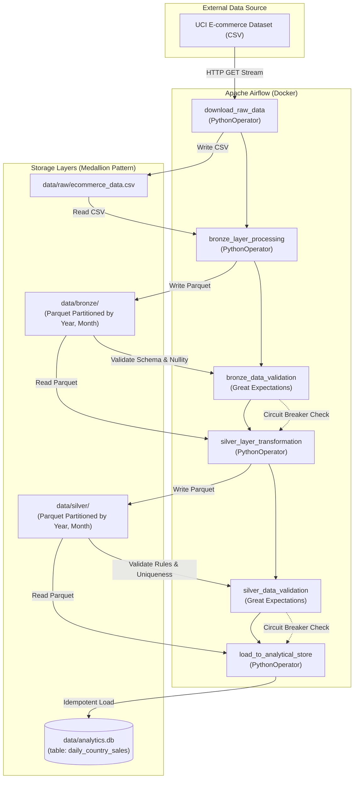

# Automated Batch ETL Pipeline with Apache Airflow and Great Expectations

[](https://airflow.apache.org/)
[](https://greatexpectations.io/)
[](https://python.org/)
[](https://docker.com/)
[](https://docs.pytest.org/)

A robust, enterprise-grade batch ETL pipeline adhering to the **Medallion Lakehouse Architecture** (Raw &rarr; Bronze &rarr; Silver &rarr; Analytical Store). Orchestrated with **Apache Airflow** and guarded by **Great Expectations** automated data quality circuit breakers to prevent data corruption from flowing into production analytical stores.

---

## Table of Contents

- [Architectural Overview](#architectural-overview)
- [Medallion Data Layering](#medallion-data-layering)
- [Repository Structure](#repository-structure)
- [Data Quality Circuit Breakers](#data-quality-circuit-breakers)
- [Transformation Business Logic](#transformation-business-logic)
- [Environment Configuration](#environment-configuration)
- [Getting Started & Execution](#getting-started--execution)
  - [Option A: Dockerized Execution (Recommended)](#option-a-dockerized-execution-recommended)
  - [Option B: Local / Python Execution](#option-b-local--python-execution)
- [Unit Testing & Verification](#unit-testing--verification)
- [SQLite Analytical Query Store](#sqlite-analytical-query-store)
- [Design Decisions & Idempotency](#design-decisions--idempotency)

---

## Architectural Overview

The pipeline ingests raw transactional e-commerce records, standardizes schema types, writes partitioned columnar Parquet files, cleanses anomalies according to business rules, aggregates sales metrics, and loads the data into SQLite for analytics.



---

## Medallion Data Layering

1. **Raw Layer (`data/raw/`)**:
   - Original, untampered CSV dataset directly streamed via HTTP/HTTPS with timeout and error checking.
   - Preserves historical source fidelity for full pipeline replays.
2. **Bronze Layer (`data/bronze/`)**:
   - Converted into Apache Parquet columnar format with explicit schema enforcement.
   - Physically partitioned by `InvoiceDate` into `Year` and `Month` directory paths for efficient temporal partitioning.
3. **Silver Layer (`data/silver/`)**:
   - Cleansed data applying domain business rules:
     - Null/missing `CustomerID` values imputed as `'UNKNOWN'`.
     - Negative quantities (`Quantity < 0`) and invalid unit prices (`UnitPrice <= 0`) eliminated.
     - Derived metric `TotalPrice = Quantity * UnitPrice`.
     - Aggregation by day-level `InvoiceDate` and `Country` to derive `DailyTotalSales`.
   - Serialized as Parquet partitioned by `Year` and `Month`.
4. **Analytical Serving Layer (`data/analytics.db`)**:
   - SQLite relational database serving layer containing table `daily_country_sales`.
   - Enables data analysts and BI dashboards to execute SQL queries.

---

## Repository Structure

```
project_root/
├── .env.example                                  # Documented environment variables template
├── docker-compose.yml                            # Multi-container orchestration (Airflow, Postgres, etl-service)
├── Dockerfile.etl                                # Custom Airflow/Python container image
├── requirements.txt                              # Python library dependencies
├── README.md                                     # Project architecture & user guide
├── dags/
│   └── ecommerce_analytics_pipeline.py           # Airflow DAG definition (@daily, exact 6-task flow)
├── etl_scripts/
│   ├── __init__.py                               # Package exports
│   ├── raw_downloader.py                         # HTTP GET data ingestion
│   ├── bronze_processor.py                       # Parquet conversion & partitioning
│   ├── silver_transformer.py                     # Business cleansing & daily aggregation
│   ├── analytics_loader.py                       # SQLite idempotent loading
│   └── validator.py                              # Great Expectations circuit breaker runner
├── great_expectations/
│   ├── great_expectations.yml                    # GX configuration
│   ├── checkpoints/
│   │   ├── bronze_checkpoint.yml                 # Bronze validation checkpoint
│   │   └── silver_checkpoint.yml                 # Silver validation checkpoint
│   └── expectations/
│       ├── bronze_expectations.json              # Bronze schema & type expectations
│       └── silver_expectations.json              # Silver aggregation & uniqueness expectations
├── tests/
│   ├── __init__.py                               # Tests package
│   ├── test_silver_transformer.py                # Pytest suite for silver business logic
│   └── test_circuit_breakers.py                  # Pytest suite for GX circuit breaker tripping
└── data/
    ├── raw/                                      # Ingested CSV location
    ├── bronze/                                   # Partitioned Bronze Parquet
    └── silver/                                   # Partitioned Silver Parquet
```

---

## Data Quality Circuit Breakers

In automated pipelines, silent data corruption is hazardous. If corrupted or malformed data enters the pipeline, Great Expectations halts execution immediately via the **Circuit Breaker** pattern, raising a non-zero exit code that marks the Airflow validation task as `FAILED` and skips downstream tasks (`upstream_failed`).

### Bronze Expectations Suite (`bronze_expectations.json`)
- `expect_column_to_exist`: Validates presence of `InvoiceNo`, `StockCode`, `Quantity`, `InvoiceDate`, `UnitPrice`, `CustomerID`, `Country`.
- `expect_column_values_to_not_be_null`: Asserts non-null values for `InvoiceNo` (mandatory invoice ID) and `CustomerID` (accounting for guest checkout proportions).
- `expect_column_values_to_be_of_type`: Confirms `Quantity` is `int64` and `UnitPrice` is `float64`.
- `expect_column_values_to_be_between`: Asserts `Quantity` values are positive transactions (`min_value: 1`).

### Silver Expectations Suite (`silver_expectations.json`)
- `expect_column_to_exist`: Validates presence of `InvoiceDate`, `Country`, `DailyTotalSales`.
- `expect_column_values_to_not_be_null`: Asserts `DailyTotalSales` contains no nulls.
- `expect_compound_columns_to_be_unique`: Enforces strict uniqueness across the composite key `['InvoiceDate', 'Country']`.
- `expect_column_values_to_be_between`: Asserts `DailyTotalSales >= 0.0`.
- `expect_table_row_count_to_be_between`: Verifies output row count constraints (`min_value: 1`).

---

## Transformation Business Logic

Defined in `etl_scripts/silver_transformer.py`:
1. **CustomerID Imputation**: Missing or blank customer IDs are imputed to string `'UNKNOWN'` so guest checkout revenues are preserved rather than dropped.
2. **Transaction Filtering**: Records with `Quantity < 0` (returns/cancellations) or `UnitPrice <= 0` (promotional/error items) are removed.
3. **Metric Calculation**: Calculates `TotalPrice = Quantity * UnitPrice`.
4. **Daily Aggregation**: Normalizes `InvoiceDate` to day-level (`YYYY-MM-DD`) and aggregates by `['InvoiceDate', 'Country']`, calculating `DailyTotalSales = sum(TotalPrice)`.
5. **Physical Partitioning**: Derives `Year` and `Month` and saves as Apache Parquet partitioned dataset.

---

## Environment Configuration

Copy `.env.example` to `.env`:

```bash
cp .env.example .env
```

Key environment variables:
| Variable | Description | Default |
|---|---|---|
| `AIRFLOW_UID` | Host UID for container permissions | `50000` |
| `AIRFLOW_IMAGE_NAME` | Docker image tag | `custom-airflow-etl:latest` |
| `POSTGRES_USER` | Metadata DB user | `airflow` |
| `POSTGRES_PASSWORD` | Metadata DB password | `airflow` |
| `POSTGRES_DB` | Metadata DB database name | `airflow` |
| `DATASET_URL` | Remote dataset ingestion URL | Databricks retail CSV |
| `DATA_DIR` | Mount path for data | `/opt/airflow/data` |
| `SQLITE_DB_PATH` | Path to SQLite serving DB | `/opt/airflow/data/analytics.db` |

---

## Getting Started & Execution

### Option A: Dockerized Execution (Recommended)

1. **Build and spin up containerized environment**:
   ```bash
   docker-compose up -d --build
   ```

2. **Access Airflow UI**:
   - Navigate to [http://localhost:8080](http://localhost:8080)
   - Credentials: Username `admin`, Password `admin`

3. **Trigger DAG**:
   - Unpause and trigger `ecommerce_analytics_pipeline` in the Web UI or run:
   ```bash
   docker-compose exec etl-service airflow dags trigger ecommerce_analytics_pipeline
   ```

4. **Run Unit Tests inside Container**:
   ```bash
   docker-compose exec etl-service pytest
   ```

---

### Option B: Local / Python Execution

1. **Install dependencies**:
   ```bash
   pip install -r requirements.txt
   ```

2. **Run end-to-end pipeline execution**:
   ```bash
   python -c "
   from etl_scripts import download_raw_data, process_to_bronze, transform_to_silver, load_to_sqlite, validate_bronze_layer, validate_silver_layer
   download_raw_data('https://raw.githubusercontent.com/databricks/Spark-The-Definitive-Guide/master/data/retail-data/by-day/2010-12-01.csv', 'data/raw/ecommerce_data.csv')
   process_to_bronze('data/raw/ecommerce_data.csv', 'data/bronze')
   validate_bronze_layer('data/bronze')
   transform_to_silver('data/bronze', 'data/silver')
   validate_silver_layer('data/silver')
   load_to_sqlite('data/silver', 'data/analytics.db')
   print('ETL Pipeline successfully completed.')
   "
   ```

3. **Run Unit Tests locally**:
   ```bash
   pytest tests/ -v
   ```

---

## Unit Testing & Verification

The test suite in `tests/` comprehensively verifies business logic and Great Expectations circuit breaker tripping:

```bash
$ pytest tests/ -v
============================= test session starts =============================
tests/test_circuit_breakers.py::test_valid_bronze_validation PASSED      [  9%]
tests/test_circuit_breakers.py::test_bronze_circuit_breaker_on_missing_column PASSED [ 18%]
tests/test_circuit_breakers.py::test_bronze_circuit_breaker_on_invalid_type PASSED [ 27%]
tests/test_circuit_breakers.py::test_valid_silver_validation PASSED      [ 36%]
tests/test_circuit_breakers.py::test_silver_circuit_breaker_on_negative_sales PASSED [ 45%]
tests/test_circuit_breakers.py::test_silver_circuit_breaker_on_duplicate_composite_keys PASSED [ 54%]
tests/test_circuit_breakers.py::test_validate_bronze_layer_raises_exception_on_corrupted_directory PASSED [ 63%]
tests/test_silver_transformer.py::test_customer_id_imputation PASSED     [ 72%]
tests/test_silver_transformer.py::test_filter_invalid_records PASSED     [ 81%]
tests/test_silver_transformer.py::test_total_price_arithmetic_and_aggregation PASSED [ 90%]
tests/test_silver_transformer.py::test_end_to_end_silver_transformation PASSED [100%]

============================= 11 passed in 2.23s ==============================
```

---

## SQLite Analytical Query Store

The final table `daily_country_sales` in `data/analytics.db` contains clean daily aggregate figures ready for reporting:

```sql
SELECT InvoiceDate, Country, DailyTotalSales
FROM daily_country_sales
ORDER BY DailyTotalSales DESC
LIMIT 5;
```

**Sample Output**:
| InvoiceDate | Country | DailyTotalSales ($) |
|---|---|---|
| `2010-12-01` | United Kingdom | 43,267.40 |
| `2010-12-01` | France | 855.86 |
| `2010-12-01` | EIRE | 555.38 |
| `2010-12-01` | Australia | 358.25 |
| `2010-12-01` | Germany | 261.48 |

---

## Design Decisions & Idempotency

- **Idempotency Guarantee**: Rerunning the DAG produces identical outputs without duplication. Directory writes use directory clearing before Parquet serialization, and SQLite loading utilizes `if_exists='replace'`.
- **Partition Pruning**: Parquet datasets in both Bronze and Silver layers are partitioned by `Year` and `Month`, accelerating downstream query engines.
- **Separation of Concerns**: Business and data transformation logic resides exclusively in `etl_scripts/`, keeping the DAG file purely declarative.
- **Standardized Logging**: Python's standard `logging` library records timestamps, step progressions, record counts, and full error tracebacks.
